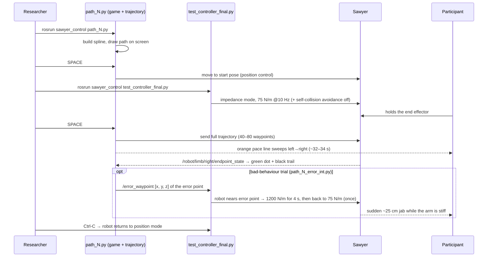

# Sawyer HRI Study: Robot Control Workspace

ROS (Noetic) workspace and scripts for a human–robot interaction user study run on a Rethink **Sawyer** arm at the University of Waterloo. Participants physically hold the robot's end effector while it traces a path shown on a screen. The robot runs in a compliant **Cartesian impedance** mode, so participants feel it guiding them and can push back. In some trials the robot deliberately makes a mistake.

> Companion repo: **[hri-sensing-toolkit](https://github.com/AmrHamdi97/hri-sensing-toolkit)** has the camera (Intel RealSense) and physiological sensor (Shimmer3 GSR+) recording used in the same sessions.

---

## 1. Overview

This code was used in a **user study** of physical human–robot interaction. Each participant held the Sawyer's end effector while the robot traced a path shown on a screen, and tried to keep the robot's position (a green dot) on the path in step with a moving pace line. During every trial the arm stays compliant, so the participant feels it guiding them and can push it off course.

Each path was run with **good** or **bad** robot behaviour:

| Behaviour | Scripts | What the participant experiences |
|---|---|---|
| **Good** | `path_1.py`, `path_2.py`, `path_3.py` | The robot follows the path shown on screen; the arm stays soft |
| **Bad** | `path_1_error_int.py`, `path_2_error_int.py`, `path_3_error_int.py` | Partway along the path the robot makes one sudden ~25 cm upward jab. As it approaches, the controller raises the arm's stiffness, so the participant can't hold it on the path |

The scripts also contain a second kind of error, **`path_N_error_ctrl.py`**: the robot drifts smoothly 10–22 cm away from the displayed path. This was developed as an alternative form of error and **was not used in the study** (see section 3).

---

## 2. How a trial works



### The screen
- Everything happens in one vertical plane in front of the robot (X is fixed). Robot **Y → screen X** and robot **Z → screen Y**, with Z flipped so up is up.
  - Path: `screen_x = 1900·y + 770`, `screen_y = 1200 − 2000·z`
  - Live robot dot: `screen_x = 1900·y + 770`, `screen_y = 1180 − 1950·z`. This is slightly different from the path mapping, so the dot can sit up to ~15 px off the path near the top and bottom.
- **Red dots** show the target path (1000-point dense spline). The **green circle** is the robot's live position. The **black trail** is where the robot has actually been since motion started.
- The **orange pace line** moves 0.75 px per frame at 60 fps, about **34 s** for the full path (0.8 px per frame ≈ 32 s in `path_2.py`). The participant's goal is to keep the circle on the path, in step with the line.

### The robot side (all `path_*.py` scripts)
1. **IK**: KDL `ChainIkSolverPos_LMA` on `sawyer.urdf` (base → `right_hand`). Each solve is seeded with the previous solution, so consecutive waypoints stay on the same IK branch. The gripper always points straight down (quaternion `(0, 1, 0, 0)`).
2. **Motion**: `intera_motion_interface.MotionTrajectory`. Each waypoint is a **joint-angle** target. Speed and acceleration limits are 0.1 (joint speed ratio 0.1). The whole trajectory is built first, then sent at once.
3. **Compliance** comes from the separate controller node (section 4). The scripts themselves only send a position trajectory, and the impedance controller makes it feel springy.

---

## 3. The study scripts

All are in `src/sawyer_control/scripts/visualizers_final/`. Start pose is always (X, −0.3, 0.3) and end pose (X, 0.5, 0.3), so the robot sweeps 80 cm left to right.

### Scripts used in the study

| Script | Behaviour | Path shape | Plane X | Waypoints | What the robot does | Stiffness boost |
|---|---|---|---|---|---|---|
| `path_1.py` | good | Cubic spline "∿" (z: 0.3→0.4→0.2→0.4→0.3) | 0.75 m | 40 | follows the shown path | — |
| `path_2.py` | good | Cubic spline, inverted "∿" (z: 0.3→0.2→0.4→0.2→0.3) | 0.75 m | 80 | follows the shown path | — |
| `path_3.py` | good | 4 straight segments (z: 0.3→0.5→0.15→0.35→0.3) | 0.75 m | 5 (corners) | goes corner to corner | — |
| `path_1_error_int.py` | **bad** | same as path 1 | 0.75 m | 40 | waypoint 26 (y = 0.233 m) z 0.315 → **0.565 m**: one sudden **25 cm jab up** and back | yes, from y ≈ 0.19 m, just before the jab |
| `path_2_error_int.py` | **bad** | same as path 2 | 0.75 m | 40 | waypoint 26 z 0.285 → **0.535 m**: **25 cm jab** | yes, from y ≈ 0.19 m |
| `path_3_error_int.py` | **bad** | same as path 3 | **0.60 m** | 5 | ⚠️ follows the shown path. **This script contains no error** (identical to `path_3.py` except X; see 6.1) | — |

**How the `_error_int` (interpolation) error works.** The script builds the correct spline and draws it on screen. It then copies the 40 interpolated waypoints and pushes waypoint #26 up 25 cm (`z_spline_false[26] += 0.25`). The robot is sent the modified list, so it travels normally, makes one abrupt vertical jab, and returns to the path. While building the trajectory, the script publishes waypoint 26's position on `/error_waypoint`. The controller uses this to make the arm stiff just before the jab (section 4).

### Alternative error type (not used in the study)

`path_N_error_ctrl.py` implements a **control-point error**. One of the spline's control points is moved before interpolation, so the robot's whole path bends smoothly away from the one on screen. It feels like "the robot took a different route" rather than a glitch.

| Script | Plane X | Error |
|---|---|---|
| `path_1_error_ctrl.py` | 0.60 m | 4th control point z 0.4 → 0.2: drifts up to 21.9 cm below the path, worst at y ≈ 0.36 m |
| `path_2_error_ctrl.py` | 0.60 m | 4th control point z 0.2 → 0.3: drifts up to 10.9 cm above the path |
| `path_3_error_ctrl.py` | 0.60 m | 4th corner z 0.35 → 0.25: corner 10 cm low |

---

## 4. The controller: `test_controller_final.py`

A separate ROS node that switches Sawyer from rigid position control to **Cartesian impedance control**. The participant can then feel the robot guiding them and can push it off course. During a bad-behaviour trial, the node makes the arm stiff at the moment of the error.

### 4.1 How impedance control works

In normal position control, Sawyer drives its joints to the commanded angles and resists any push. In impedance control, the hand behaves as if it were attached to a **target point by a spring and a damper**. The path script moves that target point along the trajectory. The controller computes the force the virtual spring–damper would produce and turns it into joint torques.

For position (x, y, z), the virtual spring–damper produces a force

```math
\mathbf{F} = \mathbf{K}_t\,(\mathbf{x}_d - \mathbf{x}) + \mathbf{D}_t\,(\dot{\mathbf{x}}_d - \dot{\mathbf{x}})
```

and for orientation, a torque

```math
\mathbf{m} = \mathbf{K}_r\,\mathbf{e}_R + \mathbf{D}_r\,(\boldsymbol{\omega}_d - \boldsymbol{\omega})
```

| Symbol | Meaning | Set by |
|---|---|---|
| $`\mathbf{x}_d,\ \dot{\mathbf{x}}_d`$ | target position and velocity of the hand, which move along the path | the `path_*.py` trajectory |
| $`\mathbf{x},\ \dot{\mathbf{x}}`$ | actual hand position and velocity | measured by the robot |
| $`\mathbf{K}_t = \mathrm{diag}(k_x,k_y,k_z)`$ | translational stiffness, N/m | first 3 values of `K_impedance` |
| $`\mathbf{K}_r = \mathrm{diag}(k_{rx},k_{ry},k_{rz})`$ | rotational stiffness, N·m/rad | last 3 values of `K_impedance` |
| $`\mathbf{e}_R`$ | orientation error between the target gripper orientation (pointing down) and the actual one, as an axis-angle vector | — |
| $`\mathbf{D}_t,\ \mathbf{D}_r`$ | damping, which slows motion so the spring doesn't oscillate | `D_impedance`. Not set in this script, so Intera's built-in default damping is used |

The robot turns this force and torque into torques for its 7 joints:

```math
\boldsymbol{\tau} = \mathbf{J}(\mathbf{q})^{\top}\begin{pmatrix}\mathbf{F}\\ \mathbf{m}\end{pmatrix} + \big(\mathbf{I} - \mathbf{J}^{\top}\mathbf{J}^{+\top}\big)\,\mathbf{K}_{null}\,(\mathbf{q}_{ref} - \mathbf{q}) + \mathbf{g}(\mathbf{q})
```

- $`\mathbf{J}(\mathbf{q})`$ is the 6×7 Jacobian, which relates joint velocities to hand velocities. Its transpose maps a force at the hand to torques at the joints.
- **Null-space term.** Sawyer has 7 joints but the hand has only 6 degrees of freedom, so the elbow can swing without moving the hand. $`\mathbf{K}_{null}`$ (5 N·m/rad per joint here) gently holds the arm near its reference posture. The projector $`(\mathbf{I}-\mathbf{J}^{\top}\mathbf{J}^{+\top})`$ makes sure this doesn't push on the hand.
- $`\mathbf{g}(\mathbf{q})`$ is gravity compensation, so the arm doesn't sag even when it is very soft.

These equations are the standard Cartesian impedance law. Intera's internal implementation isn't published, but `K_impedance`, `D_impedance` and `K_nullspace` are exactly the $`\mathbf{K}`$, $`\mathbf{D}`$ and $`\mathbf{K}_{null}`$ above.

**The practical meaning.** When the participant holds the hand still against the robot, velocities are near zero and the spring term dominates. The force they must apply to keep the hand a distance $`\Delta x`$ away from the target is

```math
F \approx k\,\Delta x
```

| Hand held away from the target by | Default, 75 N/m | Error, 1200 N/m |
|---|---|---|
| 2 cm | 1.5 N | 24 N |
| 5 cm | 3.8 N | 60 N |
| 10 cm | 7.5 N | 120 N |
| 25 cm (the size of the jab) | 19 N, like holding a 2 kg bag | 300 N in theory. In practice the robot's joint torque limits cap it first: it simply goes where it wants |

For rotation, 27 N·m/rad means tilting the gripper 10° takes about 4.7 N·m.

At **75 N/m**, a participant can easily pull the hand off the robot's path, or hold it on the screen path while the robot tries to jab. At **1200 N/m**, close to Sawyer's maximum of 1300 N/m, the hand follows the robot's own trajectory almost rigidly. The jab happens whatever the participant does.

### 4.2 Settings used in the study

| Setting | Value in `test_controller_final.py` | Meaning |
|---|---|---|
| `default_stiffness` | `[75, 75, 75, 27, 27, 27]` | Soft in all directions, used for the whole trial |
| `high_stiffness` | `[1200, 1200, 1200, 30, 30, 30]` | Error stiffness: rigid, used for 4 s around the jab |
| Interaction frame | robot base frame (`set_in_endpoint_frame(False)`) | x = toward/away from the robot (depth), y = left/right on screen, z = up/down |
| Mode | impedance on all 6 axes (`[1,1,1,1,1,1]`) | no force commands (`force_command = 0`) |
| `max_impedance` | all `False` | uses the stiffness values given, rather than forcing maximum |
| `K_nullspace` | `[5]*7` N·m/rad | elbow posture spring |
| `disable_reference_resetting` | `False` | When the stiffness changes, Intera resets the spring's target so the arm doesn't jerk at the moment of the switch |
| Publish rate | 10 Hz on `/robot/limb/right/interaction_control_command` | — |

### 4.3 What the node does, step by step

1. **Starts impedance mode**: publishes the default stiffness every 0.1 s.
2. **Turns off self-collision avoidance**: a background thread publishes `Empty` to `/robot/limb/right/suppress_collision_avoidance` at 10 Hz. Without this, Sawyer's own link-collision checks can interrupt motion when the arm is pushed into unusual poses. Contact/impact safety is not affected.
3. **Waits for an error location**: subscribes to `/error_waypoint` (`Float64MultiArray [x, y, z]`). The `_error_int` scripts publish this when the trajectory is built.
4. **Watches the hand**: subscribes to `/robot/limb/right/endpoint_state`, about 100 Hz.
5. **Boosts stiffness at the error.** When the hand's y position enters the window $`[\,y_{err} - 0.04,\ y_{err}\,]`$, the node:
   - publishes the error stiffness;
   - holds it for 4 s;
   - publishes the default stiffness again.

   The window is the 4 cm just before the error point, approaching from the left. This happens **once** per run of the node.
6. **On Ctrl-C**, sends `interaction_control_active = False` 5 times, so the robot returns to position control.

### 4.4 Changing the stiffness

Both stiffness levels are plain lists at the top of the class (lines 52–53), in the order `[x, y, z, rot_x, rot_y, rot_z]`:

```python
self.default_stiffness = [75.0, 75.0, 75.0, 27.0, 27.0, 27.0]       # normal (good) behaviour
self.high_stiffness    = [1200.0, 1200.0, 1200.0, 30.0, 30.0, 30.0]  # during the error
```

- **Ranges**: translation 0–1300 N/m, rotation 0–30 N·m/rad (Intera's limits). The original run notes used 10–1200 N/m for translation.
- **Lower** default stiffness makes the robot feel lighter, and participants can move it further off the path. **Higher** default stiffness makes it guide more firmly.
- **Each axis can differ.** For example, `[500, 75, 75, 27, 27, 27]` keeps the hand locked in the drawing plane (stiff in x) while staying soft left/right and up/down. `extras/controller_variants/error_amr_final.py` uses this idea.
- **Other parameters you can tune** in the same file:

| What | Where | Effect |
|---|---|---|
| How early the boost starts | `trigger_buffer = 0.04` | metres before the error point, along y |
| How long the boost lasts | `rospy.sleep(4)` | seconds |
| Elbow stiffness | `set_K_nullspace([5.0]*7)` | N·m/rad per joint |
| Damping | add `msg.D_impedance = [...]` before returning the message | N·s/m and N·m·s/rad. `extras/controller_variants/error_controller.py` shows an example with `[8, 8, 8, 2, 2, 2]` |

The quickest way to feel a setting is to run only `test_controller_final.py` with no path script. The robot holds its current pose, and you can push it around to compare values.

Two alternative controllers that weren't used in the study are kept in `extras/controller_variants/`:
- `error_amr_final.py`: stiff in X, soft in Y/Z `[500, 30, 30, …]`. It triggers on a 3 cm 3-D distance and boosts to `[600, 1000, 1000, …]` for 6 s.
- `error_controller.py`: switches stiffness on a `/error_state` Bool topic, with explicit damping.

---

## 5. Setup and running

### Requirements
- Ubuntu 20.04, ROS Noetic, Python 3
- `python3-pykdl`, `ros-noetic-kdl-parser-py`, `ros-noetic-urdfdom-py`, `scipy`, `numpy`, `pygame`
- A Sawyer running Intera 5.x on the same network

### Build the workspace
```bash
git clone https://github.com/AmrHamdi97/sawyer-hri-study.git sawyer_ws && cd sawyer_ws
wstool init src sawyer.rosinstall        # fetches the Rethink packages at the pinned commits
rosdep install --from-paths src --ignore-src -r -y
catkin_make                               # or: catkin build
```

### Connect to the robot
Edit `intera.sh`:
- `robot_hostname="192.168.1.200"` (the lab Sawyer)
- `your_ip=...` This is auto-detected from the `wlp0s20f3` interface, so change the interface name on another PC. `ben_intera.sh` is the same file with a hard-coded IP.

Then:
```bash
./intera.sh            # opens a shell with ROS_MASTER_URI pointing at the robot
```

### Run one trial
Run everything **from the workspace root**, because the scripts open `sawyer.urdf` by relative path.
```bash
# terminal 1
rosrun sawyer_control path_1.py                 # or any script from the table
#   → press SPACE: robot moves to the start pose
# terminal 2
rosrun sawyer_control test_controller_final.py  # impedance on
#   → press SPACE in the game window: path + pace line start
# after the trial: close the game window, Ctrl-C the controller
```
**Restart the controller for every trial.** It remembers the last error point and that it has already fired.

To try the impedance feel on its own, run just `test_controller_final.py`. The robot holds its current pose and you can push it around. See section 4.4 for changing the stiffness.

---

## 6. Notes on how the code behaved as run

These come from reading the code line by line, and some matter for interpreting the data. Each one is a factual description of what the scripts do.

**Scripts used in the study:**

1. **`path_3_error_int.py` contains no error.** It is `path_3.py` with only the plane depth changed from X = 0.75 m to 0.60 m. It doesn't modify any waypoint or publish `/error_waypoint`. A path-3 "bad" trial therefore had no jab and no stiffness boost, but the robot worked 15 cm closer to its base than in the other trials.
2. **The 4 s boost probably ends partway through the jab.**
   - The boost starts at y ≈ 0.19 m.
   - From there, the hand travels about **52 cm** to finish the jab: about 3 cm along the path, 28 cm up, then 22 cm back down.
   - With the trajectory's speed limit of 0.1 m/s, that takes at least ~5 s.
   - So the arm likely goes back to 75 N/m somewhere on the way down. To cover the whole jab, increase `rospy.sleep(4)` (section 4.4).
3. **After the boost, the controller stops its 10 Hz stream.** Once `stiffness_triggered` is set, the main loop no longer republishes. Only a single default-stiffness message is sent after the boost. The wait also runs inside the `endpoint_state` callback.
4. **The controller must be restarted for every trial.** The error location and the "already fired" flag persist. If the node were left running, the next bad trial would get no boost.
5. **The good-behaviour paths aren't identical in timing:**
   - `path_2.py` uses 80 waypoints, while the others use 40 (path 3 uses 5).
   - `path_2.py` moves to the start pose at speed 0.5, while the others use 0.1.
   - `path_2.py`'s pace line is ~2 s faster.
6. **Path 3 isn't exactly straight on the robot.** Only the 5 corner points are sent, as joint-angle waypoints. Between corners the motion is interpolated in joint space, so the hand follows a slight curve rather than the straight segments drawn on screen.
7. **The run-steps file names the wrong controller.** `docs/original_run_steps.txt` says `test_controller.py`; the file actually used is `test_controller_final.py`.

**Unused `_error_ctrl` scripts** (for anyone reusing them):
- All three run at X = 0.60 m.
- `path_2_error_ctrl.py` and `path_3_error_ctrl.py` never publish `/error_waypoint`, so there is no stiffness boost.
- In `path_1_error_ctrl.py`, `execute_trajectory()` re-publishes the 4th *interpolated* waypoint, `[0.6, −0.239, 0.402]`. This overwrites the real error point, so the boost fires about 2 cm after the start instead of at the deviation. Two `rospy.sleep(1)` calls also delay the robot ~2 s behind the pace line.

---

## 7. Everything else in the package

| Path | What it is |
|---|---|
| `scripts/visualizers_v1/` | First prototypes of the game and controller |
| `scripts/visualizers_final/` (other files) | Development iterations: `path_4–7`, `six_splines*` (multi-level game), `pid_controller*`, `two_points*`, `queue_test`, `controller_v2/v3`, `test_controller_2`, `test_controller_toni_v1`, `path_1_*_amr*` |
| `scripts/test/` | IK, trajectory and impedance experiments |
| `scripts/record_effort_values.py` | Logs end-effector forces/torques and joint torques to `~/sawyer_effort_logs/*.csv` |
| `scripts/amr_cartesian.py`, `amr_spline.py` | Cartesian / spline motion experiments |
| `split_controller/` | **Later (Aug 2025) modular rewrite**: 6 levels × 2 runs (Normal = robot creeps to the end point at 1 mm/s and the participant leads; Tracking = robot follows the spline at 20 mm/s), 30 s timer, success radius, auto-restart between runs. Entry point `main.py`; levels in `config.py`. Not used in the user study. |
| `sawyer.urdf` / `sawyer_original.urdf` | Robot model used for IK (and the unmodified original) |
| `docs/sample_data/joint_angles_log_sample.csv` | Example joint-angle log (time + `right_j0…j6`) |
| `patches/` | Local edits that existed in the vendored `intera_sdk` examples and `sawyer_simulator`. They aren't needed by the study, but are kept for completeness |

## 8. Upstream code

The Rethink Robotics packages (`intera_sdk`, `intera_common`, `sawyer_robot`, `sawyer_moveit`, `sawyer_simulator`, `sns_ik`) are **not** committed here. `sawyer.rosinstall` pins them to the exact commits used. They are Apache-2.0 licensed by Rethink Robotics.
